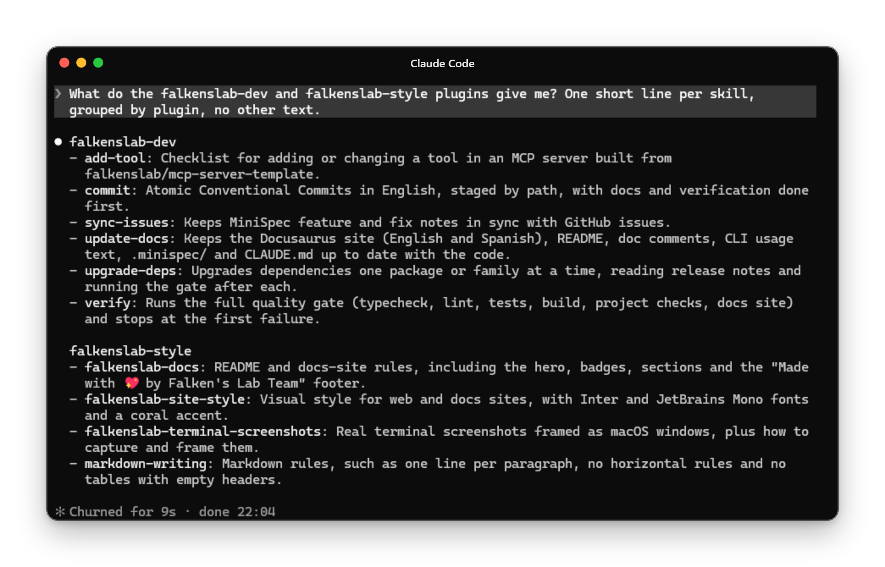

<div align="center">


# falkenslab-plugins

**Give Claude Code the way Falken's Lab works, in every repository and on every machine.**<br/>
One marketplace, two plugins: the development workflow and the house style, installed in a minute.


[](LICENSE)

</div>

falkenslab-plugins is a [Claude Code](https://code.claude.com/docs) plugin marketplace with the skills Falken's Lab uses across its repositories: commit, verify, document, release and keep issues in sync like every other project does, and write READMEs, documentation sites and screenshots that look like the rest of the family. Add the marketplace once, install the plugins you want, and Claude Code picks the skills up whenever the task calls for them.

## ✨ Why falkenslab-plugins

- 🧩 **One install instead of copies.** The skills every repository carried in its own `.claude/skills/` now live in one place, versioned and shared.
- 🎯 **Generic, but project-aware.** The workflow skills read each project's `CLAUDE.md`, `.minispec/`, `package.json` and CI, and step aside when a repository has its own version of a skill.
- 🎨 **A consistent house style.** READMEs, Docusaurus sites, terminal screenshots and Markdown follow the same rules in every Falken's Lab project.
- ✋ **Nothing outward without asking.** No push, release, publish or new repository unless you ask for it; `release` only runs when you invoke it.
- 🔁 **Always up to date.** `/plugin marketplace update` brings every machine to the latest version of the skills.

## 🚀 Quick start

You need [Claude Code](https://code.claude.com/docs) 2.1 or later. In a Claude Code session:

```
/plugin marketplace add falkenslab/falkenslab-plugins
/plugin install falkenslab-dev@falkenslab-plugins
/plugin install falkenslab-style@falkenslab-plugins
/reload-plugins
```

The skills show up as `/falkenslab-dev:<skill>` and `/falkenslab-style:<skill>`, and Claude also loads them by itself when a task needs them.

<details>
<summary>Prefer the menus?</summary>

Run `/plugin`, open the **Marketplaces** tab, choose **+ Add Marketplace** and type `falkenslab/falkenslab-plugins`. Then pick the plugins in **Discover** and choose the scope to install them in (you, this project, or this project only on your machine).

</details>

## 💬 What you can ask

- 🛠️ **As a developer**: "commit this", "run the checks", "update the docs for the new option", "sync the issues with the MiniSpec notes", "bump the MCP SDK", "add a `list_courses` tool".
- 🚢 **As a maintainer**: `/falkenslab-dev:release` decides the semver bump, writes the notes, tags, creates the GitHub release and publishes to npm.
- 🎨 **As a writer**: "rewrite this README in the Falken's Lab style", "give the docs site our look", "take a screenshot of this session for the README", "fix the Markdown in `docs/guide.md`".

## 📸 See it at work

Claude Code with both plugins installed, asked what they give you:

<div align="center">



</div>

## 🧰 What's inside

| Plugin | Skills |
| --- | --- |
| 🛠️ [falkenslab-dev](./plugins/falkenslab-dev/) | `commit`, `verify`, `update-docs`, `release`, `sync-issues`, `upgrade-deps`, `add-tool` |
| 🎨 [falkenslab-style](./plugins/falkenslab-style/) | `falkenslab-docs`, `falkenslab-site-style`, `falkenslab-terminal-screenshots`, `markdown-writing` |

MiniSpec's skills (`minispec-*`) aren't here: `npx @falkenslab/minispec init` installs them in each repository that uses [MiniSpec](https://github.com/falkenslab/minispec).

## 📚 Documentation

- **[falkenslab-dev](./plugins/falkenslab-dev/)**: the development workflow skills, what each does and what it needs.
- **[falkenslab-style](./plugins/falkenslab-style/)**: the house style skills, their templates and scripts.
- **[Create plugins](https://code.claude.com/docs/en/plugins)**: how Claude Code plugins work.
- **[Plugin marketplaces](https://code.claude.com/docs/en/plugin-marketplaces)**: how a marketplace like this one is built and distributed.

## 🛠️ Developing

Each plugin lives in `plugins/<name>/` with its `.claude-plugin/plugin.json` and one folder per skill, and is registered in `.claude-plugin/marketplace.json`; [CLAUDE.md](./CLAUDE.md) has the conventions. Check your changes with `claude plugin validate .` and try a plugin without installing it with `claude --plugin-dir plugins/<name>`.

<div align="center">

Made with 💖 by Falken's Lab Team

</div>
